# @オーバーライド

個人サイト兼、自分で使う小さなツールの置き場です。サーバーは持たず、Spotify・Steam・GitHub などのデータは GitHub Actions が定期的に JSON にしてリポジトリへ commit し、GitHub Pages から静的に配信しています。

サイト: https://fuyuiro.pages.dev

[](https://github.com/terasaki-8910/terasaki-8910.github.io/actions/workflows/update-spotify.yml)
[](https://github.com/terasaki-8910/terasaki-8910.github.io/actions/workflows/update-steam.yml)
[](https://github.com/terasaki-8910/terasaki-8910.github.io/actions/workflows/update-github-activity.yml)
[](https://github.com/terasaki-8910/terasaki-8910.github.io/actions/workflows/update-trakt.yml)

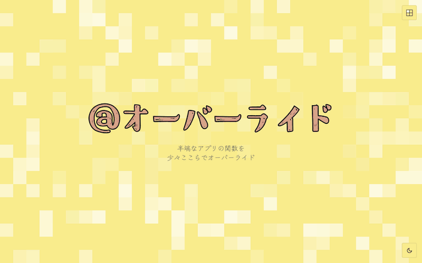

<sub>トップを上から順に見て、右上の 2×2 のメニューからごみ収集カレンダーへ移るところです。スクロールに合わせて GitHub の草が横に流れ、別のページへ移るときは背景のマス目が画面を埋めてから切り替わります。</sub>

## 目次

- [特徴](#特徴)
- [構成](#構成)
- [ページと機能](#ページと機能)
- [ディレクトリ構成](#ディレクトリ構成)
- [開発](#開発)
- [クレジット](#クレジット)

## 特徴

- サーバーなしで、外部のデータを毎日更新する。6 本のワークフローが cron で外部 API を呼び、結果を JSON として `public/` と `docs/` に書いて commit します。API キーは GitHub Secrets にだけ置き、ブラウザには届きません。
- 意味のないコミットを積まない。前回と中身が同じなら書き込まず、取得に失敗したら終了コード 1 で止めて前回のデータを残します。同じ時刻に動くワークフロー同士で push がぶつかったときは `git pull --rebase` して最大 5 回再試行します。
- ページごとに必要なものだけ読み込む。Vite のマルチページ構成で、Three.js はホームと 3D ASCII、GSAP と Lenis はホームだけが読み込みます。Spotify のページは React を使わない静的 HTML です。
- 第三者の画像は複製しない。ジャケット・ポスター・ファンアート・ゲームアイコンは各サービスの CDN へ直リンクし、ファンアートには絵師名と出典へのリンクを添えています。
- ライト／ダーク、スマホ幅、動きを減らす設定に対応。テーマは選んだものを次回も覚えます（初回は OS の設定に関係なくライト）。`prefers-reduced-motion` では演出を省きます。
- 日本語フォントは使う字だけに絞る。ソースとデータ（町名・キャラ名など）から表示される文字を集め、fontTools でサブセットを作ります。

## 構成

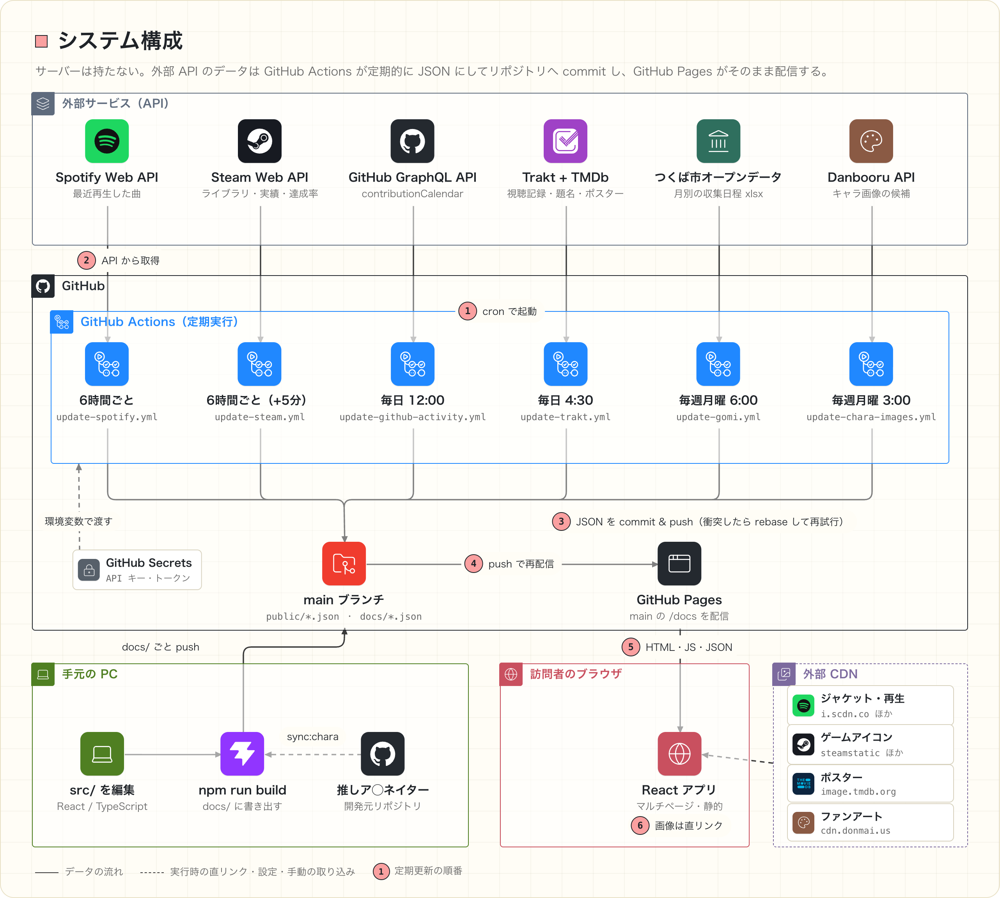

1. GitHub Actions のワークフローが cron で起動します（Spotify と Steam は 6 時間ごと、GitHub と Trakt は毎日、つくば市と Danbooru は毎週）。
2. 外部 API からデータを取得します。キーは GitHub Secrets から環境変数で渡します。
3. ページが読む形に整えた JSON を `public/` と `docs/` に書き、commit・push します。
4. GitHub Pages は main ブランチの `/docs` を配信しているので、push だけで公開中のサイトに反映されます。
5. ブラウザはビルド済みの HTML・JS と、この JSON を読み込みます。
6. 画像は各サービスの CDN から直接読み込みます。

画面やロジックの変更は手元で `npm run build` して `docs/` を作り直し、`docs/` ごと push します。推しア◯ネイターの推定エンジンとデータは別リポジトリ（開発元）で作り、`npm run sync:chara` で取り込みます。

### 定期更新の流れ

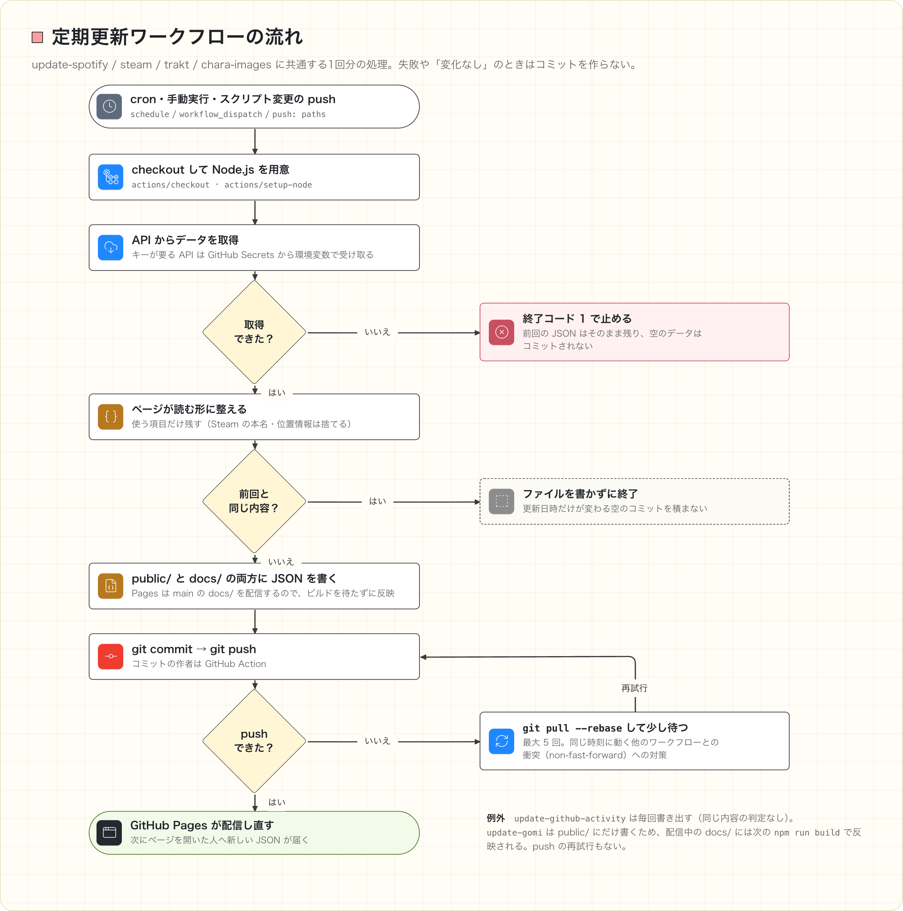

### 技術スタック

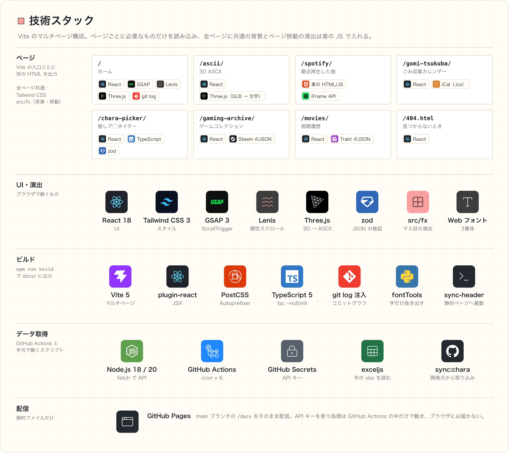

| 分類 | 使っているもの |
| --- | --- |
| UI | React 18 / TypeScript（推しア◯ネイターのみ）/ Tailwind CSS 3 / zod（読み込んだ JSON の検証） |
| 演出 | GSAP 3（ScrollTrigger）/ Lenis / Three.js / 素の JS（背景のマス目とページ移動） |
| ビルド | Vite 5（マルチページ）/ PostCSS / `tsc --noEmit` で型チェック |
| データ取得 | Node.js 18・20 / GitHub Actions / exceljs（市の xlsx の読み込み） |
| 配信 | GitHub Pages（main ブランチの `/docs`） |

## ページと機能

### ホーム `/`

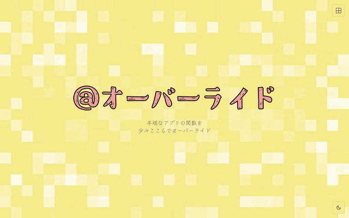

- GitHub の活動：GraphQL API の `contributionCalendar` を毎日取得し、活動のあった日だけを箱にして並べます。デスクトップでは縦スクロールに合わせて帯が横に流れます（GSAP ScrollTrigger の pin）。箱の高さはその日の件数、上下のずれは日付から決まるので、開くたびに配置が変わることはありません。
- プロジェクト：各ページへのリンクに、中身を縮めたプレビューを載せています（3D ASCII のビューア、最近の 3 曲、今日と明日のごみ、おまかせで 1 体、最近 2 週間に遊んだゲーム、最近観た 3 作品）。
- 更新履歴：ビルド時に `git log`（親コミット付き）を取り込み、ブランチとマージをグラフで描きます。自動更新のコミットは除き、それをまたいでも線がつながるよう祖先をたどり直します。

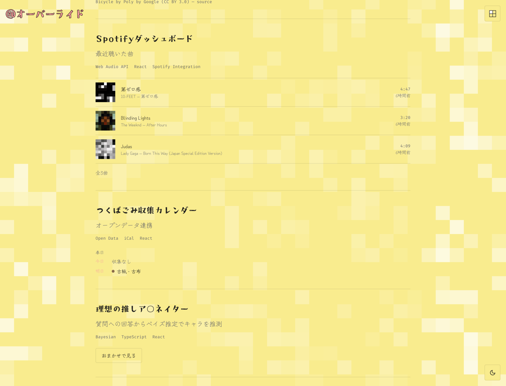

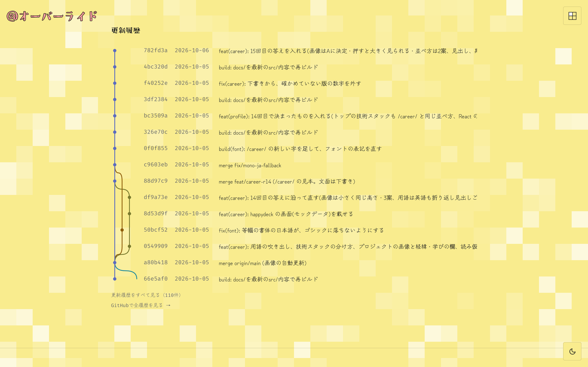

### 3D ASCII `/ascii/`

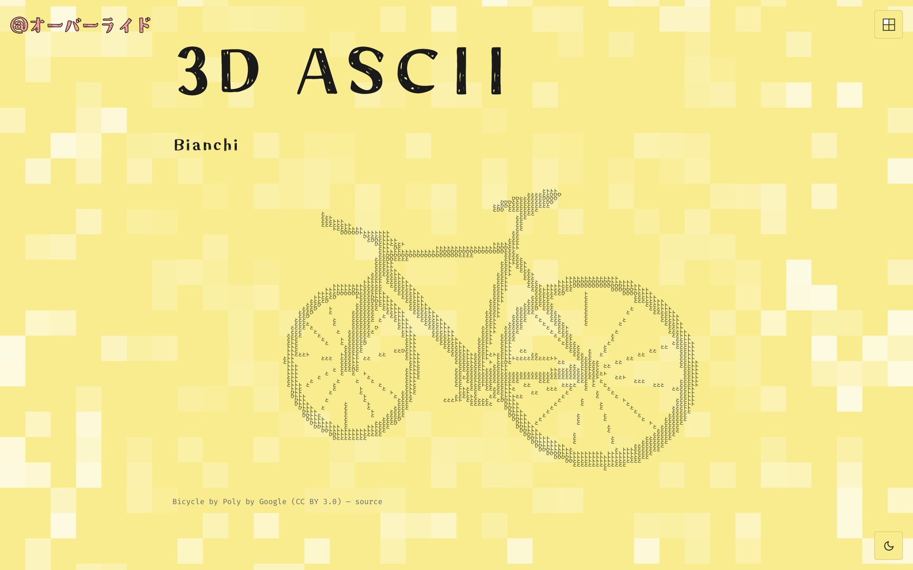

GLB モデルを Three.js で描き、その明るさを文字に置き換えて表示します。文字は密度順に並べた文字セットから選び、テーマの色に合わせて描き直します。

### 最近再生した曲 `/spotify/`

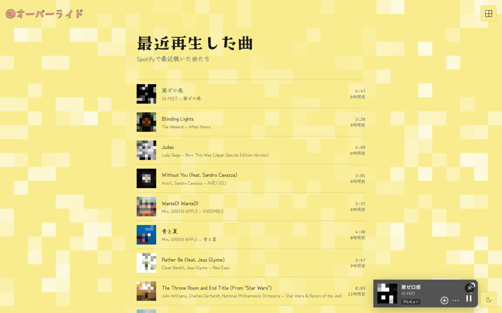

Spotify の再生履歴（直近 30 曲）を 6 時間ごとに取得して並べます。曲を押すと Spotify の埋め込みプレイヤー（iFrame API）で再生します。このページは React を使わない静的 HTML で、ヘッダーは `npm run sync-header` で React 側のものから写しています。

### つくばごみ収集カレンダー `/gomi-tsukuba/`

<table>
  <tr>
    <td width="50%">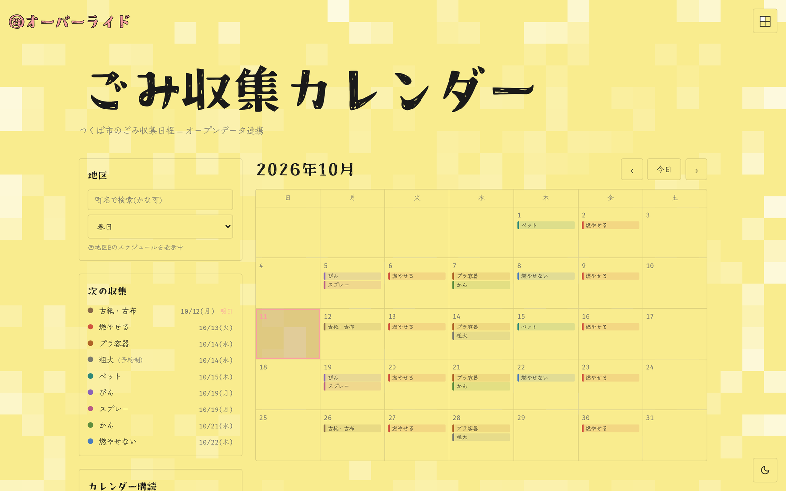</td>
    <td width="50%">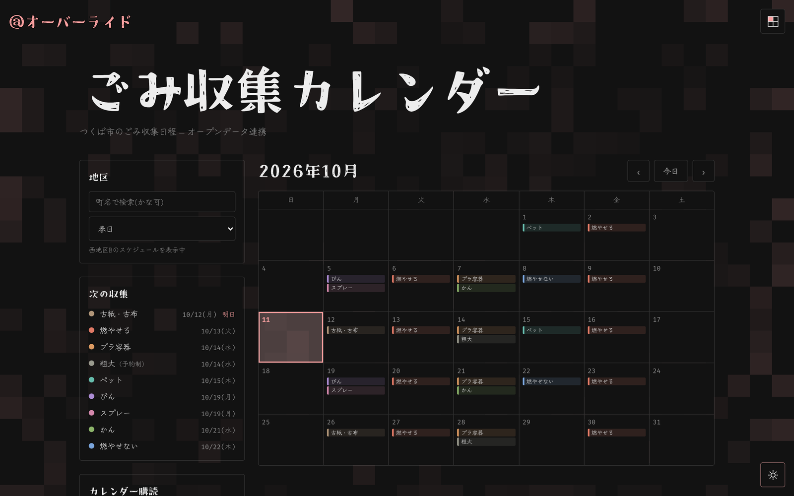</td>
  </tr>
</table>

つくば市が公開している月別の xlsx を毎週読み込み、収集日程の JSON と地区ごとの iCal（`.ics`）を作ります。225 の町名は 5 つの収集地区にまとまるので、データは町と地区の対応表と地区ごとの日程に分けています。町名はかなでも検索でき、Google カレンダーへの追加・`.ics` のダウンロード・購読用 URL のコピーができます。詳しくは [documentation/gomi-tsukuba-calendar.md](documentation/gomi-tsukuba-calendar.md)。

### 理想の推しア◯ネイター `/chara-picker/`

<table>
  <tr>
    <td width="50%">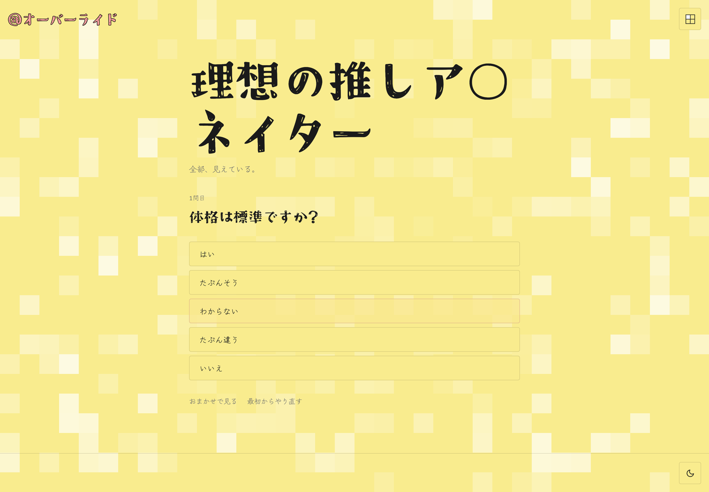</td>
    <td width="50%">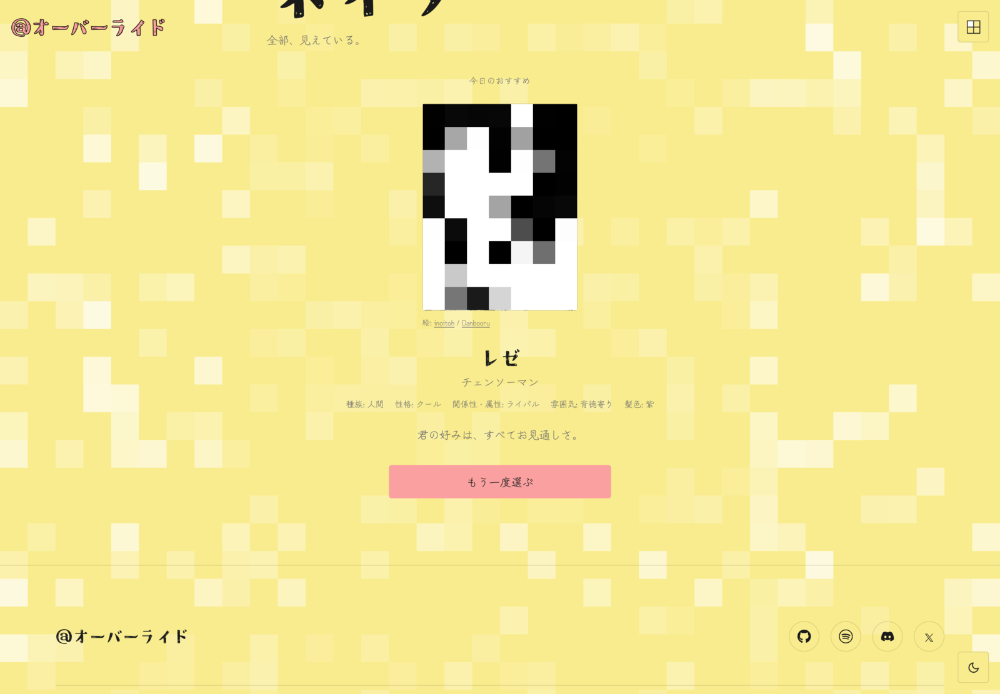</td>
  </tr>
</table>

質問に答えていくと、1008 体のキャラクターからベイズ推定で 1 体を当てます（最初の推測までの質問は多くて 15 問）。「わからない」と答えたり、質問なしの「おまかせ」で選んだりもできます。エンジンとデータは開発元のリポジトリと同じファイルを `npm run sync:chara` で取り込み、ハッシュを記録して、こちらで手を入れていたら取り込みを止めます。キャラの画像は Danbooru から週 1 回 CI で候補を選んで JSON にしておき、表示は CDN への直リンクです（ブラウザから Danbooru の API を直接呼ぶと Cloudflare に止められるため）。詳しくは [documentation/chara-picker.md](documentation/chara-picker.md)。

### 遊んだゲームコレクション `/gaming-archive/`

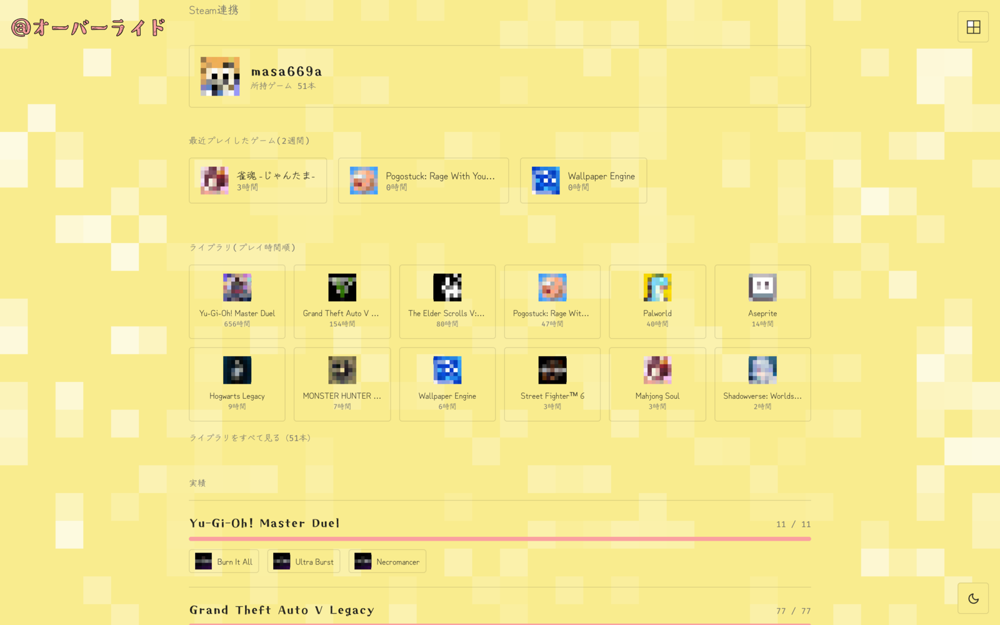

Steam Web API から、最近 2 週間に遊んだゲーム、プレイ時間順のライブラリ、実績を取得します。実績にマウスを乗せると、全プレイヤーのうち何 % が達成しているかを表示します。API が返す本名や位置情報は保存しません。

### 映画・アニメ・ドラマの視聴履歴 `/movies/`

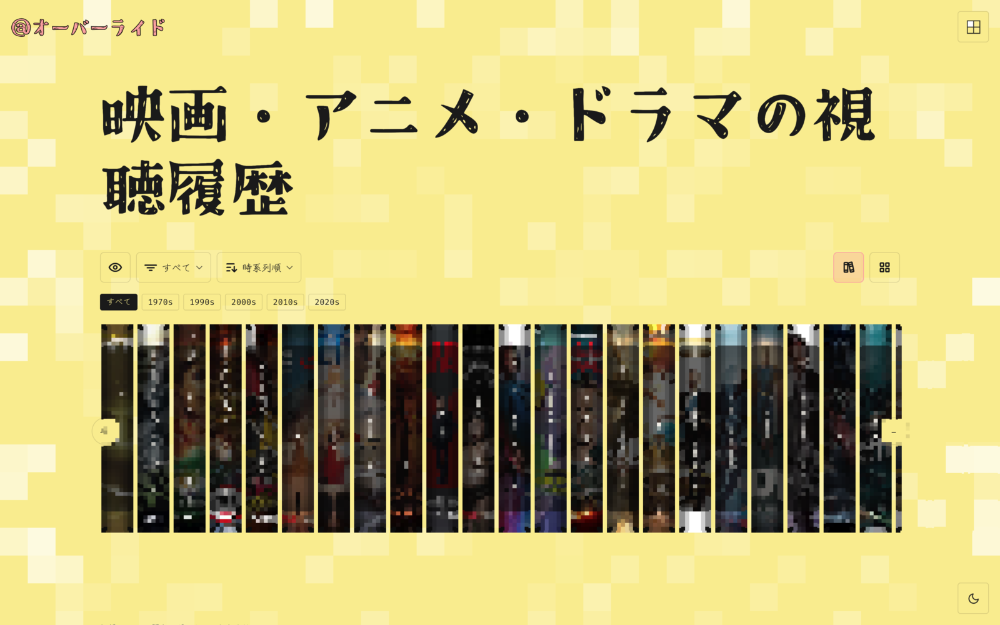

Trakt に記録した「観た・評価・観たい」を毎日取得し、TMDb から日本語の題名・ポスター・あらすじを補います。本棚の背表紙のように並べ、種類での絞り込みと並べ替え、年代での絞り込みができます。本棚の上でホイールを回すと横に動きます。

### スマホ表示

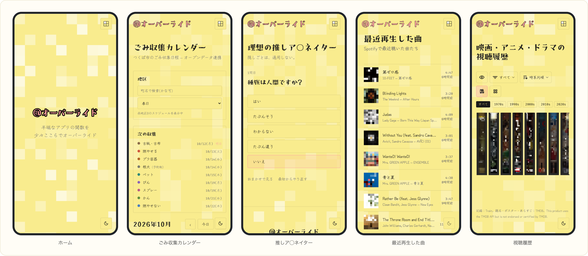

<sub>README の画像では、第三者の画像（ジャケット・ポスター・ファンアート・ゲームアイコン）をモザイクにしています。</sub>

## ディレクトリ構成

```
.
├── index.html, ascii/, spotify/, gomi-tsukuba/, …   Vite の入口(ページごとの HTML)
├── src/
│   ├── components/      React のコンポーネント
│   ├── chara/           推しア◯ネイター(エンジンとデータは開発元から同期)
│   ├── fx/              背景のマス目・ページ移動・メニューの演出(素の JS)
│   ├── data/            プロジェクト一覧・経歴などのデータ
│   └── utils/           ASCII 描画・iCal 生成など
├── public/              そのまま配信するファイル(定期更新の JSON、フォント、アイコン)
├── docs/                ビルド結果。GitHub Pages はここを配信する
├── scripts/             データ取得・フォントのサブセット化・同期のスクリプト
├── documentation/       実装ドキュメントと README の画像
└── .github/workflows/   定期更新のワークフロー
```

## 開発

```bash
npm install
npm run dev          # 開発サーバー
npm run build        # docs/ にビルド
npm run preview      # ビルド結果をローカルで確認
npm run typecheck    # 型チェック(tsc --noEmit)
```

| コマンド | 内容 |
| --- | --- |
| `npm run sync-header` | React のヘッダーを静的な Spotify ページへ写す |
| `npm run build-font-subset` | 表示する文字を集めて Zen Kurenaido のサブセットを作り直す（Python の fontTools が必要） |
| `npm run sync:chara` / `sync:chara:check` | 推しア◯ネイターのエンジンとデータを開発元から取り込む／差分を確かめる |

### 公開のしかた

GitHub Pages は「Deploy from a branch」で main ブランチの `/docs` を配信しています。main への push では、これとは別に `deploy.yml` も GitHub Actions 上で `npm run build` をやり直して公開します。どちらも同じ中身になるよう、ソースを変えたら手元でも `npm run build` で `docs/` を作り直し、一緒に commit して push します。定期更新のワークフローは `docs/` の JSON も直接書き換えるので、ビルドを待たずに反映されます。

自動更新のコミットが先に入っていて push が通らないときは、`git pull --rebase origin main` してから push し直します。

### 定期更新に使う Secrets

| ワークフロー | Secrets |
| --- | --- |
| `update-spotify.yml` | `SPOTIFY_CLIENT_ID` / `SPOTIFY_CLIENT_SECRET` / `SPOTIFY_REFRESH_TOKEN` |
| `update-steam.yml` | `STEAM_API_KEY` / `STEAM_ID` |
| `update-github-activity.yml` | `GH_CONTRIB_TOKEN` |
| `update-trakt.yml` | `TRAKT_CLIENT_ID` / `TMDB_READ_ACCESS_TOKEN`（または `TMDB_API_KEY`） |
| `update-gomi.yml` / `update-chara-images.yml` | なし |

Spotify のリフレッシュトークンが失効したときは `scripts/get-refresh-token.js` で取り直します（取得したトークンは画面に出さず `gh secret set` へ直接渡します）。

## クレジット

- アイコン: 若狭フユ（イラスト: Yasson / 吉田夜世）
- メニューの魔人のランプ: Magic lamp icon by Lorc（[game-icons.net](https://game-icons.net)）, [CC BY 3.0](https://creativecommons.org/licenses/by/3.0/)
- 3D モデル: Bicycle by Poly by Google, CC BY 3.0
- ごみ収集日程: つくば市オープンデータ（CC BY 4.0）
- 視聴履歴: [Trakt](https://trakt.tv) / [TMDB](https://www.themoviedb.org)。This product uses the TMDB API but is not endorsed or certified by TMDB.
- キャラクター画像: [Danbooru](https://danbooru.donmai.us)（各絵師の作品。表示は直リンクで、絵師名と出典を併記）
- 書体: Craft Mincho / Zen Kurenaido / Fira Mono / Klee One
